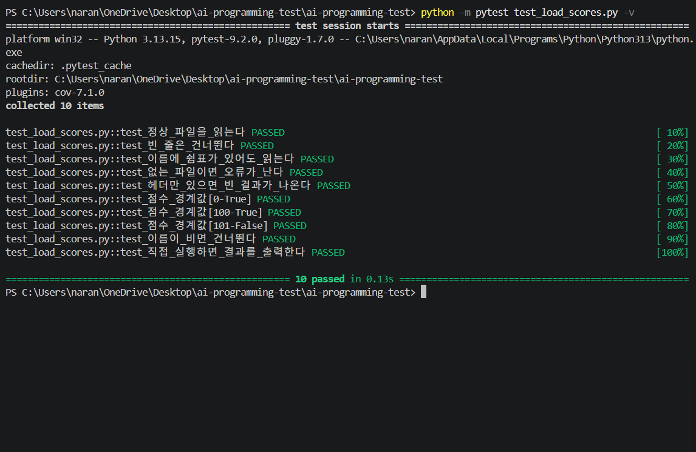

# 성적 관리 프로그램

<!--
  README 여섯 칸 빈 양식입니다.
  이 파일의 이름을 README.md 로 바꾸고, 아래 여섯 칸을 채우세요.
  <!-- 로 시작하는 줄은 설명이므로 다 채운 뒤 지우면 됩니다.

  판정 기준 — 처음 보는 사람이 3분 안에 실행할 수 있는가.
  마지막에 짝이 실제로 해 봅니다.
-->

## ① 무엇을 하나요 (What)

성적 CVS를 읽어 유효한 이름만 골라 내고 건너뛴 줄은 이유와 함께 기록한다


## ② 왜 만들었나요 (Why)          ★ AI는 이 칸을 못 씁니다

실제 파일에는 빈 칸, 범위 밖 점수, 쉼표가 섞인 이름이 있어 그냥 읽으면 프로그램이 멈추기 때문이다


## ③ 어떻게 쓰나요 (How)

<!-- 설치와 실행 명령을 그대로 복사해 붙일 수 있게. 직접 실행해 보고 적으세요. -->

```bash
# 설치
pip install pytest pytest-cov
# 실행
python load_scores.py scores.csv
```

## ④ 어떻게 테스트하나요

<!-- pytest 실행 방법과, 통과했을 때 나오는 화면을 붙여 넣으세요. -->

```bash
python -m pytest test_load_scores.py
```

```
collected 10 items

test_load_scores.py ..........                                           [100%]

============================= 10 passed in 0.20s ==============================
```


## ⑤ 파일 구성

<!-- 어떤 파일이 무엇을 하는지 한 줄씩. -->

| 파일 | 하는 일 |
| --- | --- |
| load_scores.py | 성적 CSV를 읽어 유효한 점수와 건너뛴 줄을 돌려주는 프로그램 |
| test_load_scores.py | 직접 설계한 테스트 |
| scores.csv | 실행 예시용 성적 파일 |
| empty.csv | 헤더만 있는 파일 |
| weird.csv | 잘못된 줄이 여러 종류 섞인 예시 파일 |
| prompts.txt | AI에게 테스트를 맡길 때 쓴 프롬프트 A · B |
| bug3_logic.py | AI가 버그를 정답으로 굳히는지 보려고 사용한 버그가 든 코드 |
| LICENSE | MIT 라이선스 |

## ⑥ 만든 사람 · AI를 어디에 썼는지

<!--
  이름 · 학번, 그리고 AI를 어느 부분에 썼고 무엇을 직접 판단했는지 적으세요.
  커밋 메시지에 넣은 Assisted-by: 줄과 내용이 맞아야 합니다.
-->

- 만든 사람 : 2026100590 박세환
- AI를 쓴 곳 : 테스트 코드의 틀을 만들고 pytest 사용법과 오류 메시지를 읽는 데 Claude의 도움을 받았다. 비교 실험용 test_ai_A.py, test_ai_B.py는 AI가 만든 것을 고치지 않고 그대로 저장했다.
- 내가 직접 판단한 것 :  명세를 보고 정상 · 예외 · 경계값 케이스를 설계한 것, 커버리지에서 안 지나간 줄의 이유를 적은 것, 테스트를 직접 실행해 통과를 확인한 것, AI 테스트와 내 테스트를 비교한 것.

## 라이선스

<!-- 저장소를 만들 때 고른 라이선스를 적으세요. 없으면 아무도 이 코드를 쓸 수 없습니다. --> 

MIT License (LICENSE 파일 참고)
